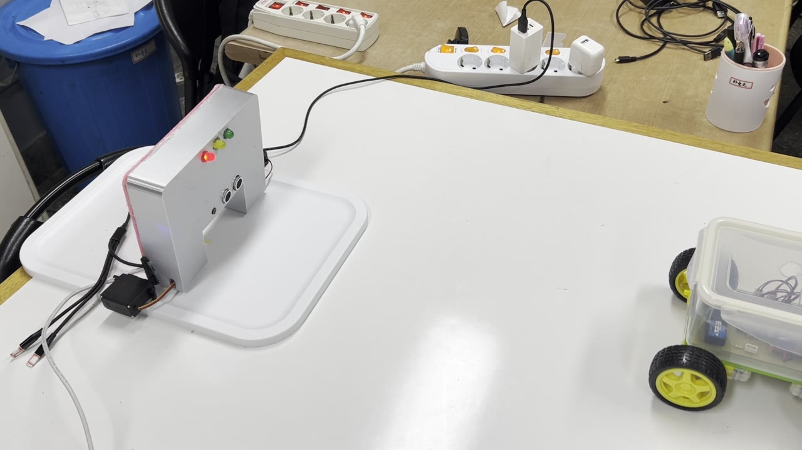
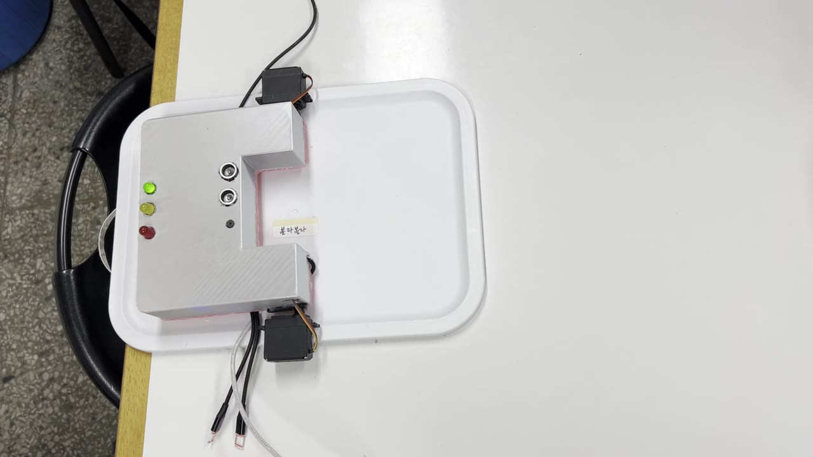
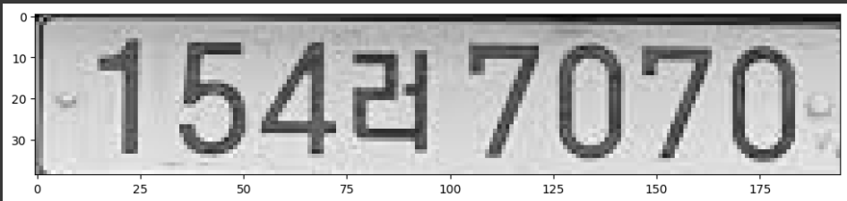
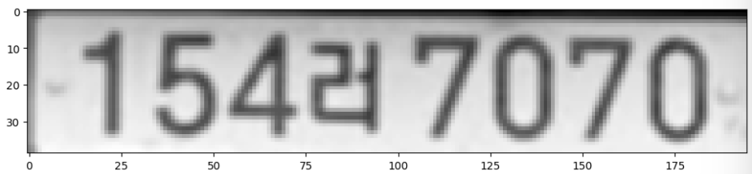
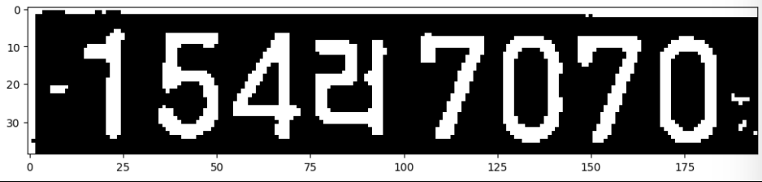
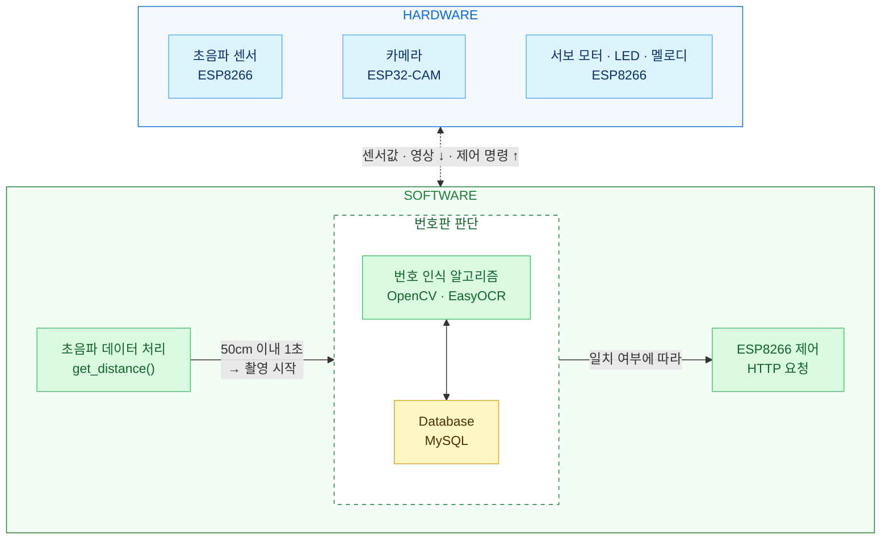

# 스마트 볼라드
**Smart Bollard**

> 차량 번호판을 인식해 사전 등록된 차량만 장애인 · 전기차 충전 구역에 들어올 수 있도록 볼라드를 자동으로 내리고 올리는 시스템

`2024 임베디드SW경진대회 자유공모` · `2024.07 – 2024.09` · `4인 팀`

왼쪽: 대기 상태 — 볼라드를 세우고 빨간 LED 표시 / 오른쪽: 등록 차량 확인 후 서보 2개로 볼라드를 눕혀 진입 허용

&nbsp;

**목차** · [개요](#1-개요) · [시스템 구성](#2-시스템-구성) · [한계 및 개선 방향](#3-한계-및-개선-방향) · [폴더 구조](#4-폴더-구조)

&nbsp;

## 1. 개요

장애인 주차 구역과 전기차 충전 구역은 시각적인 표시에만 의존하고 있어 불법 주차가 자주 발생합니다.  
기존 주차 금지 장치인 볼라드에서 아이디어를 얻어, 번호판을 인식해 등록된 차량에게만 볼라드를 내려주는 시스템을 만들었습니다.  
팀명은 볼라볼라이며, 시스템을 네 파트로 나눠 진행했습니다.

개발완료보고서 → [`smart-bollard-report.pdf`](docs/report/smart-bollard-report.pdf)  
전체 시스템 코드 (펌웨어 · 제어) → [`team-code/`](team-code/)  
팀 원본 저장소 → [Yunseo-Cho/2024ESWContest_free_1090](https://github.com/Yunseo-Cho/2024ESWContest_free_1090)

[↑ 목차](#목차)

&nbsp;

## 2. 시스템 구성

| &nbsp;&nbsp;&nbsp;&nbsp;&nbsp;&nbsp;&nbsp;&nbsp;&nbsp;&nbsp;&nbsp;&nbsp;&nbsp;&nbsp;&nbsp;&nbsp;&nbsp;&nbsp; | ① 번호판 인식 조윤서 | ② [DB 구축 · 연동](license-plate-database/) **안유빈** (설계 · 구현 · 통합) | ③ 볼라드 제어 · 통신 장서윤 | ④ 회로 · 3D 모델링 박세준 |
|---|---|---|---|---|
| **하드웨어** | ESP32-CAM | PC · MySQL 서버 | ESP8266 · 초음파 센서 · 서보 2개 | LED 3색 · 멜로디 IC · 부저 · 볼라드 외형 |
| **입력** | 카메라 프레임 | 인식된 번호판 후보 | 초음파 거리 · DB 판단 결과 | — |
| **처리** | 전처리(Gray · Blur · 이진화 · 평활화) → EasyOCR → 번호판 형식 필터링 | 공백 제거 → 정확 일치 조회, 최대 3회 시도 | 대기 → 승인 · 미승인 → 하강 → 주차 → 출차 → 상승 상태 전환 | ESP 모듈 · LED · 멜로디 IC 회로 설계, 볼라드 3D 모델링 · 프린팅 |
| **출력** | 번호판 후보 문자열 | 등록 여부 `True` · `False` | HTTP 요청으로 서보 · LED · 멜로디 · 부저 제어 | 양쪽 서보로 볼라드를 눕히는 구조 |

초음파 센서가 50cm 이내에서 1초 이상 차량을 감지하면 촬영을 시작하고, ① → ② → ③ 순서로 판단해 볼라드를 움직입니다.  
② DB 구축 · 연동의 데모 · 동작 원리 · 코드 · 개발 과정은 [`license-plate-database/`](license-plate-database/)에서 볼 수 있습니다.

<b>① 번호판 전처리 과정</b>

 

원본 → 블러 · 대비 보정 → 이진화

<b>기능 설계도</b> — 하드웨어와 소프트웨어의 연결

 

파랑: 하드웨어 · 초록: 소프트웨어 · 노랑: ② DB 구축 · 연동

[↑ 목차](#목차)

&nbsp;

## 3. 한계 및 개선 방향

**한계**

- 번호판 검출 모델 없이 거리 조건으로 촬영 시점을 맞추는 방식이라 차량 · 번호판 위치에 따라 인식률이 달라짐
- 로컬 MySQL 서버와 고정 IP 기반이라 실제 주차장 배포 · 원격 관리 구조는 갖추지 않음
- Raspberry Pi에서 PyTorch(EasyOCR)가 동작하지 않아 최종 시연은 PC에서 실행
- 축소 모형 · 실내 환경에서만 테스트했으며 야간 · 우천 등 실외 조건은 검증하지 않음

**개선 방향**

- 경량 OCR 모델 적용으로 임베디드 보드 단독 실행
- 번호판 검출 모델 재도입으로 거리 조건 없이 안정적인 인식
- 모바일 앱 연동으로 원격 차량 등록 · 볼라드 상태 확인 및 제어
- 클라우드 DB · 출입 기록 저장으로 주차 패턴 분석 및 운영 최적화

[↑ 목차](#목차)

&nbsp;

## 4. 폴더 구조

<pre>
smart-bollard/
├── <a href="license-plate-database/">license-plate-database/</a>             ② DB 구축 · 연동 (상세 README · SQL · 코드)
├── <a href="team-code/">team-code/</a>                          전체 시스템 코드 (PC · ESP8266 · ESP32-CAM)
└── <a href="docs/">docs/</a>
    ├── <a href="docs/images/">images/</a>                         대표 결과 이미지
    └── <a href="docs/report/smart-bollard-report.pdf">report/</a>                         개발완료보고서 (PDF)
</pre>

[↑ 목차](#목차)
