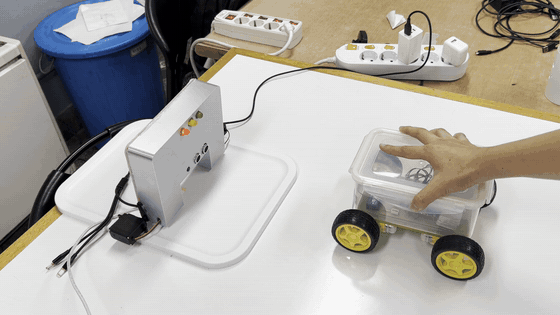
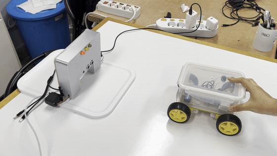
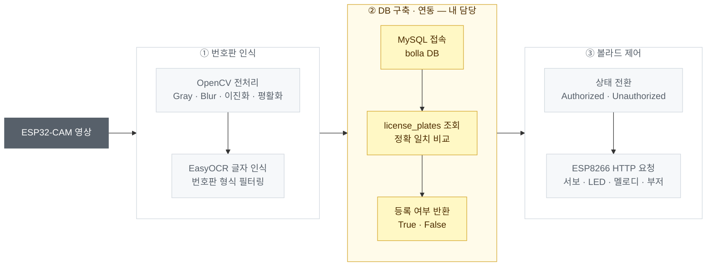
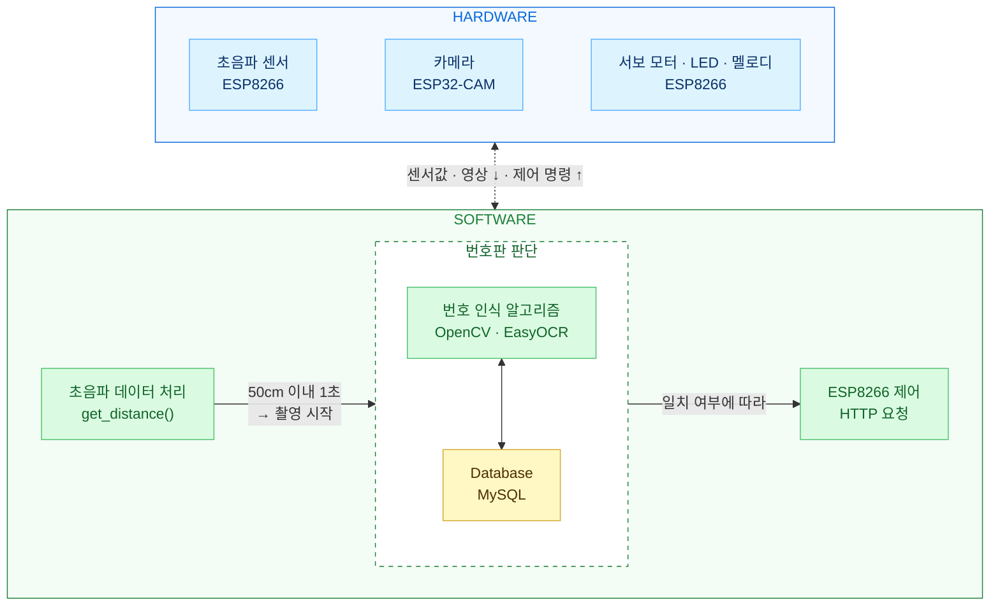
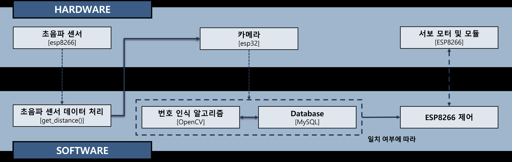
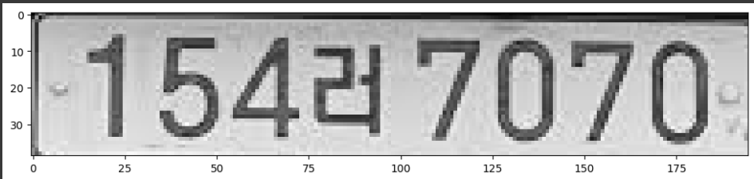
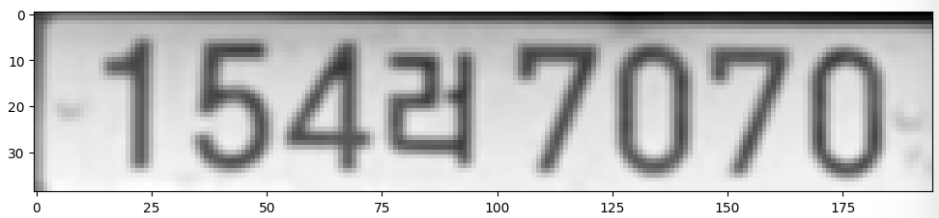
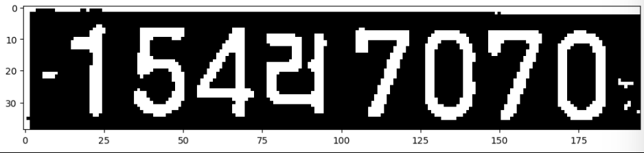
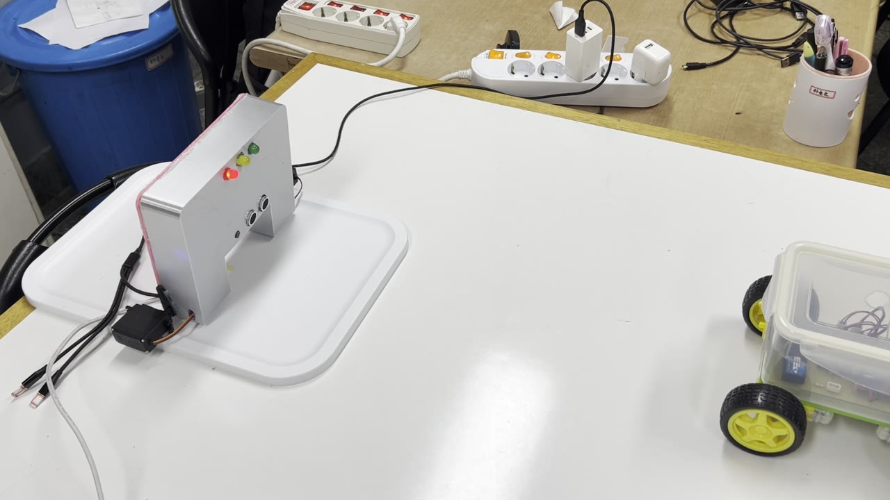
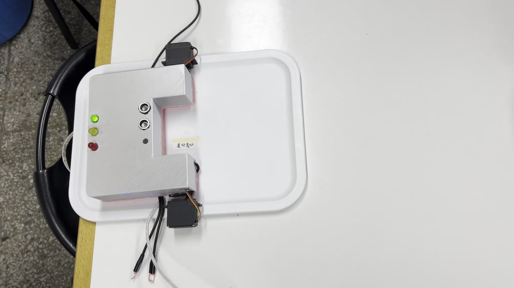

# 스마트 볼라드
**Smart Bollard**

차량 번호판을 인식해 사전 등록된 차량만 장애인 · 전기차 충전 구역에 주차할 수 있도록 볼라드를 자동 제어하는 시스템

`2024 임베디드SW경진대회 자유공모` · `2024.07 – 09` · `4인 팀` · [`개발완료보고서 (PDF)`](docs/report/smart-bollard-report.pdf) · [`시연 영상`](https://youtu.be/_QFrg2LsPvQ) · [`팀 원본 저장소`](https://github.com/Yunseo-Cho/2024ESWContest_free_1090)

왼쪽: 등록 차량 — 번호판 일치 → 녹색 LED · 볼라드 하강 / 오른쪽: 미등록 차량 — 빨간 LED 점멸 · 볼라드 유지

## 개요

장애인 주차 구역과 전기차 충전 구역은 시각적 표시에만 의존하고 있어 불법 주차가 자주 발생합니다.
기존 주차 금지 장치인 볼라드에서 아이디어를 얻어, 번호판 인식으로 **등록된 차량에게만 볼라드를 자동으로 내려주는** 시스템을 만들었습니다.
시스템은 네 파트로 나눠 진행했습니다.

- ① **번호판 인식** — 카메라 영상에서 번호판 글자를 "무엇으로" 읽는가
- ② **[데이터베이스 구축 · 연동](license-plate-database/)** — 읽은 번호판이 "등록된 차량인가" ← 내 담당 (설계 · 구현 · 통합)
- ③ **통신 · 볼라드 작동 알고리즘** — 상태에 따라 볼라드를 "어떻게" 움직이는가
- ④ **회로 구성 · 3D 모델링** — ESP 모듈 · LED · 멜로디 IC 회로와 볼라드 외형

## 시스템 구성

**처리 흐름** — 카메라 영상이 세 파트를 거쳐 볼라드 제어 명령이 되기까지

**기능 설계도** — 하드웨어 장치와 소프트웨어 처리의 연결

파랑: 하드웨어 · 초록: 소프트웨어 · 노랑: 내 담당(Database)

기능 설계도 — 초음파 센서 · 카메라 · 서보(하드웨어)와 거리 처리 · 번호판 인식 · DB · ESP8266 제어(소프트웨어)의 연결

## ① 번호판 인식

**목표** — 카메라로 차량 번호판을 인식해 글자를 정확하게 읽어내기

- **영상 전처리** — 그레이스케일 → 가우시안 블러 → 적응형 이진화 → 히스토그램 평활화 → 1.5배 확대
- **글자 인식** — EasyOCR(한국어)로 텍스트 추출 후 `숫자 2~3자리 + 한글 1자 + 숫자 4자리` 형식만 사용 (구형 · 신형 번호판 모두 대응)
- **검출 단계 생략** — YOLOv8 번호판 검출이 일부만 잡는 문제로 제외, 번호판만 화면에 들어오는 거리에서 촬영

번호판 전처리 과정 — 원본 → 블러 · 대비 보정 → 이진화

## ② 데이터베이스 구축 · 연동 — 내 담당

**목표** — 등록 차량을 수정 가능한 DB로 구축하고, 인식된 번호판과의 일치 여부를 판단

- **테이블 설계** — `license_plates` (번호판 · 구역 유형 `장애인` / `전기차`), 시연용 차량 15대 등록
- **번호판 비교** — 파라미터 바인딩 SQL 쿼리로 정확 일치 조회, 등록 여부를 `True` / `False`로 반환
- **인식 루프 연동** — 최대 3회 인식 중 한 번이라도 일치하면 등록 차량으로 판단해 볼라드 하강 단계로 전환
- **실행 환경 이전 · 통합** — Raspberry Pi로 DB 이전 · 연동 후, Torch 호환 문제로 PC 환경으로 옮겨 전체 코드 통합

> 테이블 설계 · 비교 흐름 · 개발 과정 · 코드는 **[`license-plate-database/`](license-plate-database/)** 에서 볼 수 있습니다.

## ③ 통신 · 볼라드 작동 알고리즘

**목표** — 초음파 거리와 DB 판단 결과에 따라 볼라드와 상태 표시 장치를 자동 제어

- **상태 기반 제어** — `current_state`로 대기 → 차량 감지 → 승인 / 미승인 → 하강 → 주차 → 출차 → 상승 순환
- **HTTP 통신** — `client.py`가 ESP8266 웹 서버에 `/distance` · `/move_servo` · `/control_led` 등 요청
- **비동기화** — 멜로디를 `start_melody` / `stop_melody`로 분리하고 부저를 1회 단위로 바꿔 기능 동시 동작
- **서보 안정화** — 한 번에 180°를 움직이지 않고 5°씩 36단계로 나눠 과부하 · 전압 불안정 해결

왼쪽: 대기 상태 — 볼라드 세움 · 빨간 LED / 오른쪽: 하강 상태 — 서보 2개로 볼라드를 눕혀 진입 허용

## ④ 회로 구성 · 3D 모델링

- ESP32-CAM · ESP8266 · LED 3색 · 멜로디 IC · 부저 · 초음파 센서 회로 설계
- 볼라드 외형 · 내부 구조 3D 모델링 및 프린팅, 양쪽 서보모터로 볼라드를 눕히는 구조

## 관찰 및 개선 방향

**한계**
- 번호판 검출 모델 없이 **거리 조건**으로 촬영 시점을 맞추는 방식이라 차량 · 번호판 위치에 따라 인식률이 달라짐
- 로컬 MySQL 서버와 고정 IP 기반이라 실제 주차장 환경 배포 · 원격 관리 구조는 갖추지 않음
- Raspberry Pi에서 PyTorch(EasyOCR)가 동작하지 않아 최종 시연은 PC에서 실행
- 축소 모형 · 실내 환경에서만 테스트했으며 야간 · 우천 등 실외 조건은 검증하지 않음

**개선 방향**
- 경량 OCR 모델 적용으로 임베디드 보드 단독 실행
- 모바일 앱 연동으로 원격 차량 등록 · 볼라드 상태 확인 및 제어
- 클라우드 DB · 출입 기록 저장으로 주차 패턴 분석 및 운영 최적화
- 번호판 검출 모델 재도입으로 거리 조건 없이 안정적인 인식

## 저장소 구조

<table>
<tbody>
<tr>
<td width="33%" valign="top" align="left">

📁 <a href="license-plate-database/"><b>license-plate-database</b></a> 
② DB 구축 · 연동 — 상세 README · SQL · 연동 코드 · 개발 기록

</td>
<td width="33%" valign="top" align="left">

📁 <a href="docs/"><b>docs</b></a> 
개발완료보고서 PDF · 시연 GIF · 설계도

</td>
<td width="33%" valign="top" align="left">

🔗 <a href="https://github.com/Yunseo-Cho/2024ESWContest_free_1090"><b>팀 원본 저장소</b></a> 
ESP32-CAM · ESP8266 펌웨어, 전체 제어 코드 <code>client.py</code>

</td>
</tr>
</tbody>
</table>

## 기술 스택

`Python` `MySQL` `mysql-connector-python` `OpenCV` `EasyOCR` `C/C++` `ESP32-CAM` `ESP8266` `HC-SR04` `HTTP` `Raspberry Pi`

## 팀 구성

<table>
<thead><tr><th>이름</th><th>역할</th></tr></thead>
<tbody><tr><td>장서윤 (팀장)</td><td>③ 볼라드 동작 알고리즘 · 무선 통신</td></tr></tbody>
<tbody><tr><td>박세준</td><td>④ 내부 회로 설계 · 3D 모델링</td></tr></tbody>
<tbody><tr><td><b>안유빈</b></td><td><b><a href="license-plate-database/">② 데이터베이스 구축 · 연동</a> (설계 · 구현 · 통합)</b></td></tr></tbody>
<tbody><tr><td>조윤서</td><td>① 실시간 영상 처리 · 번호판 인식</td></tr></tbody>
</table>
