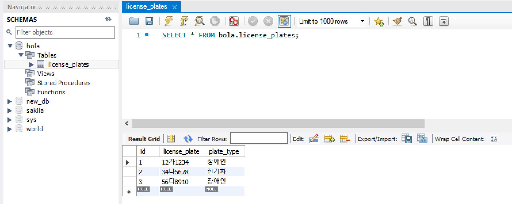
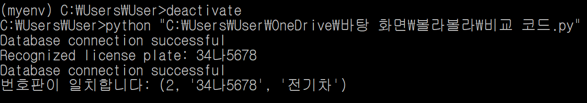
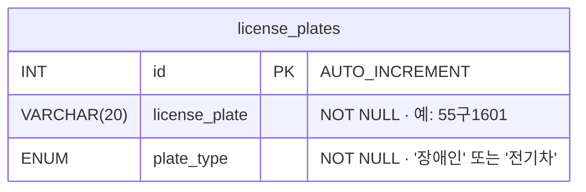
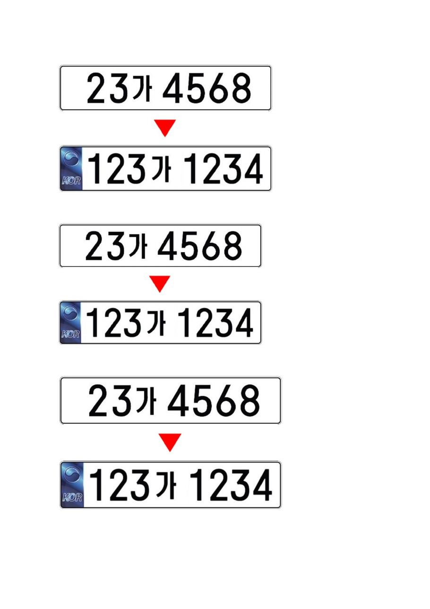
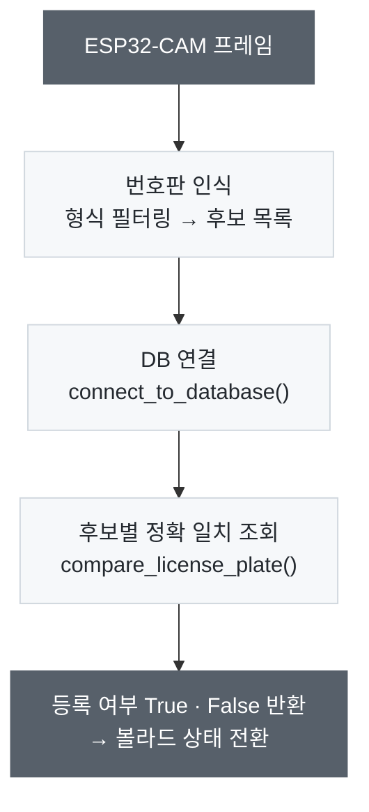
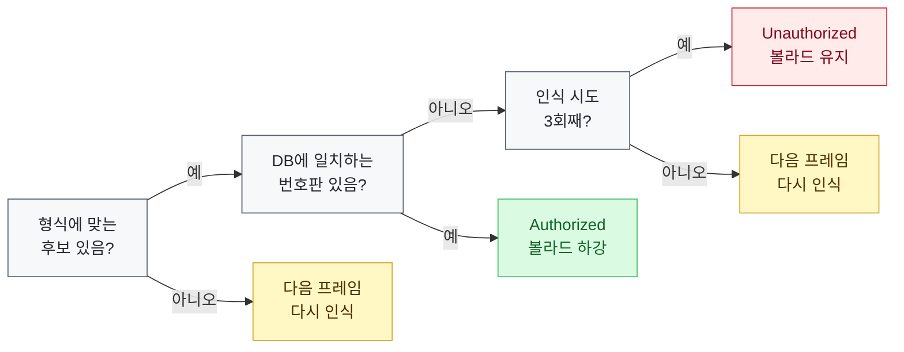
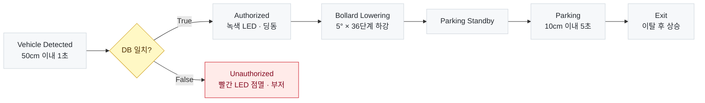
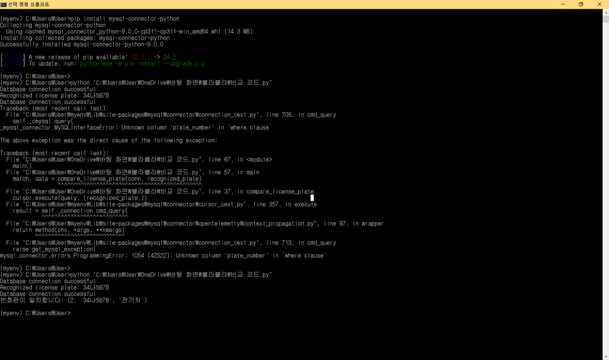
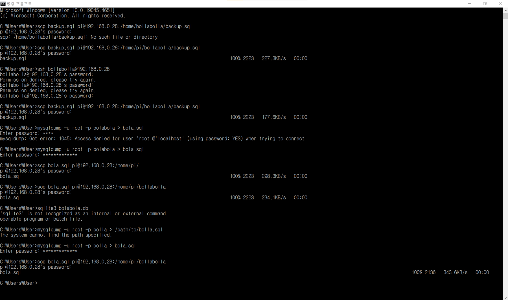

[← 프로젝트 메인](../README.md)

# ② DB 구축 · 연동
**License Plate Database** · 스마트 볼라드 중 담당 파트

> 등록 차량 번호판을 MySQL 데이터베이스로 관리하고, 인식된 번호판이 등록 차량인지 판단해 볼라드 제어 프로그램에 전달하는 모듈


<p>


</p>
<sub>왼쪽: MySQL Workbench에서 확인한 license_plates 테이블 / 오른쪽: 인식된 번호판을 DB와 비교해 일치 결과 출력</sub>

&nbsp;

<a id="목차"></a>**목차** · [개요](#1-개요) · [데모](#2-데모) · [동작 원리](#3-동작-원리) · [트러블슈팅](#4-트러블슈팅) · [한계 및 개선 방향](#5-한계-및-개선-방향) · [실행 방법](#6-실행-방법) · [폴더 구조](#7-폴더-구조)

&nbsp;

## 1. 개요

임베디드SW경진대회 프로젝트에서 ② DB 구축 · 연동 파트를 맡아 설계 · 구현 · 통합했습니다.  
번호판 인식 결과는 문자열일 뿐이라, 그 차량이 구역에 들어올 자격이 있는지는 따로 판단해야 합니다.  
처음 다뤄 보는 MySQL을 익히는 것부터 시작해, 등록 차량 DB와 비교 모듈을 만들고 팀원 코드와의 통합 · 실행 환경 이전까지 맡았습니다.

| | 처음 계획 | 실제 구현 |
|---|---|---|
| **데이터** | 실제 장애인 · 전기차 등록 정보 | 실제 데이터가 공개되어 있지 않아 시연용 번호판 15대로 직접 구성 |
| **실행 환경** | Raspberry Pi에서 DB · 인식 · 제어 통합 | Pi로 DB 이전(MariaDB) 후, PyTorch 호환 문제로 PC에서 최종 통합 |

<sub>[↑ 목차](#목차)</sub>

&nbsp;

## 2. 데모

### 등록 차량

https://github.com/user-attachments/assets/be0b1579-234d-420e-9612-1bd4a0511215

<sub>번호판 일치 → 녹색 LED · 멜로디 → 볼라드 하강</sub>

&nbsp;

### 미등록 차량

https://github.com/user-attachments/assets/42c37771-f4db-4024-b7cf-39a931de5721

<sub>번호판 불일치 → 빨간 LED 점멸 · 부저, 볼라드 유지</sub>

&nbsp;

### 전체 동작

https://github.com/user-attachments/assets/ee943a0c-2299-4359-882a-5a0a4dbe1a60

<sub>하강 → 주차 → 출차 → 볼라드 상승 (차량이 없는 대기 구간은 잘라냄)</sub>

&nbsp;

### 결과 요약

| 상황 | DB 판단 | 볼라드 동작 |
|---|---|---|
| 등록 차량 | 최대 3회 인식 중 한 번이라도 일치 → `True` | 녹색 LED · 멜로디 후 하강, 출차하면 다시 상승 |
| 미등록 차량 | 3회 모두 불일치 → `False` | 빨간 LED 점멸 · 부저, 볼라드 유지 |

<sub>[↑ 목차](#목차)</sub>

&nbsp;

## 3. 동작 원리

### 테이블 설계



<details>
<summary><b>설계 이유 · 시연 데이터</b></summary>
<br>

| 항목 | 내용 |
|---|---|
| `license_plate` | OCR 결과와 그대로 비교하도록 공백 없는 형식(`123가4567`)으로 저장 |
| `plate_type` | 구역 유형을 `ENUM`으로 제한해 잘못된 값 입력 방지, 장애인 · 전기차 구역별 확장 대비 |
| 시연 데이터 | 등록 차량 15대 (장애인 10 · 전기차 5), 구형 2자리 · 신형 3자리 번호판 모두 포함 |
| 초기화 | 스크립트를 다시 실행하면 DB를 지우고 새로 만들어, 시연 전 등록 목록을 쉽게 수정 |



<sub>시연용 번호판 출력물 — 구형 <code>23가 4568</code>(DB 등록) · 신형 <code>123가 1234</code>(미등록)</sub>

</details>

&nbsp;

### 처리 흐름



<details>
<summary><b>단계별 세부 기준</b></summary>
<br>

| 단계 | 기준 |
|---|---|
| 비교 쿼리 | `SELECT * FROM license_plates WHERE license_plate = %s` — 문자열을 쿼리에 직접 붙이지 않고 파라미터 바인딩 |
| 공백 제거 | OCR은 `154러 7070`처럼 띄어 읽기 때문에 DB 형식에 맞춰 공백을 제거한 뒤 비교 |
| 후보 여러 개 | 한 프레임에서 형식에 맞는 번호판이 여러 개 나오면 하나라도 일치하는지 확인 |
| 연결 실패 | DB 연결에 실패하면 즉시 `False`를 반환해 미등록과 같은 쪽으로 동작 |

</details>

&nbsp;

### 판단 규칙



OCR이 글자를 잘못 읽는 경우를 고려해 최대 3회까지 시도하고, 한 번이라도 일치하면 등록 차량으로 판단했습니다.

<details>
<summary><b>판단 결과와 볼라드 동작</b></summary>
<br>



| 항목 | 기준 |
|---|---|
| 판단 반영 | 차량이 30cm 이내로 1초 이상 다가왔을 때 Authorized · Unauthorized 상태로 반영 |
| 대기 복귀 | 미승인 차량이 30cm 밖으로 2초 이상 벗어나면 다시 대기 상태 |

</details>

<sub>[↑ 목차](#목차)</sub>

&nbsp;

## 4. 트러블슈팅

| # | 문제 | 해결 |
|:-:|---|---|
| 1 | `ModuleNotFoundError: No module named 'mysql'` | 가상환경(`myenv`)에 `mysql-connector-python`을 설치하고 같은 환경에서 실행 |
| 2 | `Unknown column 'plate_number' in 'where clause'` | `DESCRIBE license_plates`로 스키마를 확인한 뒤 쿼리 컬럼명 수정 |
| 3 | Raspberry Pi에 MySQL 설치 실패 | MySQL 호환 DB인 MariaDB로 교체, 노트북 DB를 `mysqldump` → `scp` → 복원 |
| 4 | Raspberry Pi에서 PyTorch 설치 불가 | 팀원들과 논의해 실행 환경을 PC(Windows)로 변경, DB 재구성 후 통합 테스트 |
| 5 | 팀원 코드에 DB 코드를 붙이기 어려움 | `connect_to_database()` · `compare_license_plate()`로 분리하고 `True` · `False` 반환 |

<details>
<summary><b>원인 자세히 보기</b></summary>
<br>

| # | 원인 |
|:-:|---|
| 1 | 커넥터를 설치한 Python과 코드를 실행한 Python 환경이 달랐음 |
| 2 | 비교 쿼리의 컬럼 이름이 실제 테이블 컬럼(`license_plate`)과 달랐음 |
| 3 | Raspberry Pi OS에서 MySQL 서버 설치 · 사용자 권한 설정 오류 |
| 4 | 번호판 인식에 쓰는 EasyOCR이 PyTorch를 필요로 하는데, Pi 하드웨어 사양과 호환되지 않음 |
| 5 | 연결 · 비교 · 테스트 출력이 하나의 스크립트에 섞여 있었음 |

<p>


</p>
<sub>왼쪽: 컬럼명 오류를 수정해 일치 결과 <code>(2, '34나5678', '전기차')</code>를 받은 실행 로그 / 오른쪽: 노트북 DB를 덤프해 Raspberry Pi로 옮기는 과정</sub>

버전별 변경 내용은 [`archive/README.md`](archive/README.md) 참고

</details>

<sub>[↑ 목차](#목차)</sub>

&nbsp;

## 5. 한계 및 개선 방향

**한계**

- 번호판 문자열 정확 일치만 비교해, OCR이 한 글자만 틀려도 미등록으로 판단
- 인식을 시도할 때마다 DB에 다시 연결하는 구조
- 시도 횟수가 후보가 나온 프레임에서만 늘어나, 번호판이 계속 안 읽히는 경우에 대한 대비가 부족함
- `license_plate`에 `UNIQUE` 제약이 없어 같은 번호판을 중복 등록할 수 있음
- 공모전 코드에는 DB 비밀번호가 코드에 직접 적혀 있었음 → [`src/plate_db.py`](src/plate_db.py)는 환경변수(`BOLLA_DB_*`)로 받도록 변경
- 로컬 DB 서버 기반이라 관리자 화면 · 원격 등록 기능과 출입 기록이 없음

**개선 방향**

- 프로그램 시작 시 한 번 연결해 재사용하고, 시도 횟수를 프레임 단위 · 시간 제한으로 관리
- `UNIQUE` 제약 추가와 함께 모바일 앱 · 웹 관리 화면에서 차량 등록 · 삭제
- 출입 기록 테이블 추가로 구역별 이용 패턴 분석
- 클라우드 DB로 여러 볼라드가 하나의 등록 목록 공유

<sub>[↑ 목차](#목차)</sub>

&nbsp;

## 6. 실행 방법

```bash
pip install -r requirements.txt
mysql -u root -p < sql/database.sql      # bolla DB · 테이블 생성 (기존 DB는 삭제 후 새로 생성)

export BOLLA_DB_PASSWORD=<비밀번호>
python src/plate_db.py 55구1601          # → 등록 차량
python src/plate_db.py 123가1234         # → 미등록 차량
```

- DB 생성 스크립트 → [`sql/database.sql`](sql/database.sql)
- 연결 · 비교 모듈 → [`src/plate_db.py`](src/plate_db.py) (팀 원본 `client.py`에서 DB 부분만 분리)
- 패키지 목록 → [`requirements.txt`](requirements.txt)
- 카메라 · 볼라드 제어를 포함한 전체 시스템은 [`team-code/client.py`](../team-code/client.py)로 실행합니다.

<sub>[↑ 목차](#목차)</sub>

&nbsp;

## 7. 폴더 구조

<pre>
license-plate-database/
├── <a href="README.md">README.md</a>
├── <a href="requirements.txt">requirements.txt</a>                      패키지 목록
├── <a href="sql/">sql/</a>
│   └── <a href="sql/database.sql">database.sql</a>                      DB · 테이블 생성, 시연용 등록 차량
├── <a href="src/">src/</a>
│   └── <a href="src/plate_db.py">plate_db.py</a>                       DB 연결 · 번호판 비교 모듈
├── <a href="archive/">archive/</a>                              개발 코드 · SQL v1 ~ v4
└── <a href="docs/images/">docs/images/</a>                          README 이미지
</pre>

<sub>[↑ 목차](#목차)</sub>
