[← 프로젝트 메인](../README.md)

# ② 데이터베이스 구축 · 연동

**License Plate Database** · 스마트 볼라드 프로젝트 중 내 담당 파트

등록 차량 번호판을 MySQL 데이터베이스로 관리하고,
카메라로 인식한 번호판이 등록된 차량인지 판단해 볼라드 제어 프로그램에 전달하는 모듈


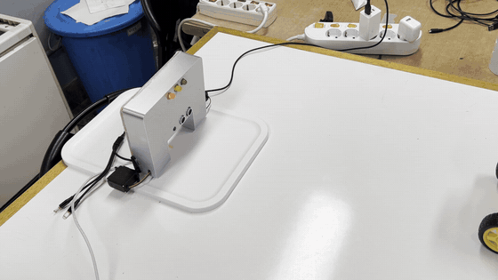
<sub>전체 동작 (6배속) — 차량 접근 → 번호판 인식 · DB 일치 → 볼라드 하강 → 주차 → 출차 → 볼라드 상승</sub>

<p>
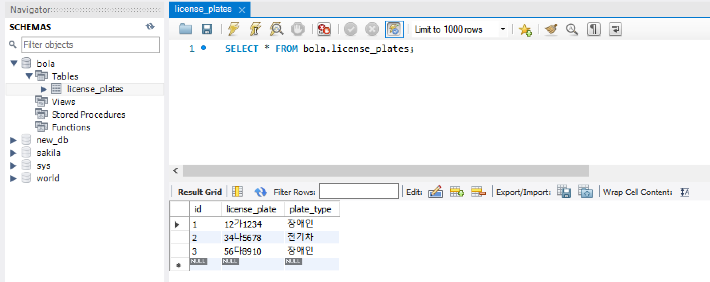
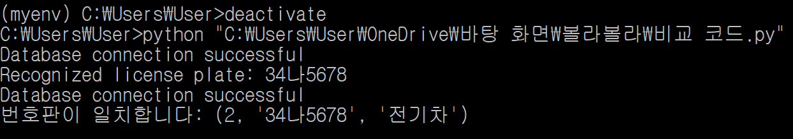
</p>
<sub>왼쪽: MySQL Workbench에서 확인한 license_plates 테이블 / 오른쪽: 인식된 번호판을 DB와 비교해 일치 결과 출력</sub>

---

## 개요

2024 임베디드SW경진대회 자유공모에 출품한 스마트 볼라드 프로젝트입니다.
시스템을 네 파트로 나눠 진행했습니다.

- ① 번호판 인식
- ② **데이터베이스 구축 · 연동** ← 내 담당 (설계 · 구현 · 통합)
- ③ 통신 · 볼라드 작동 알고리즘
- ④ 회로 구성 · 3D 모델링

번호판 인식 결과는 문자열일 뿐이라, 그 차량이 **이 구역에 들어올 자격이 있는지**는 별도로 판단해야 합니다.
이 파트는 등록 차량 DB를 만들고, 인식 결과를 DB와 비교해 **볼라드를 내릴지 말지의 근거**를 제공합니다.
처음 다뤄 보는 MySQL을 익히는 것부터 시작해, 팀원 코드와의 통합 · 실행 환경 이전까지 맡았습니다.

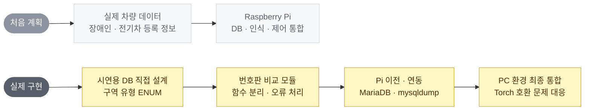

> 실제 장애인 · 전기차 등록 데이터는 공개되어 있지 않아, 시연용 번호판으로 DB를 직접 구성했습니다.

---

## 저장소 구조

📁 <b>license-plate-database</b> &nbsp;·&nbsp; <code>README.md</code> <code>requirements.txt</code>

<table>
<tbody>
<tr>
<td width="50%" valign="top" align="left">

📁 <a href="sql/"><b>sql</b></a><br>
<sub>최종 DB · 테이블 생성 및 시연용 등록 차량 데이터</sub>

<code>database.sql</code>

</td>
<td width="50%" valign="top" align="left">

📁 <a href="src/"><b>src</b></a><br>
<sub>DB 연결 · 번호판 비교 모듈 (최종 <code>client.py</code>에서 분리)</sub>

<code>plate_db.py</code>

</td>
</tr>
</tbody>
<tbody>
<tr>
<td width="50%" valign="top" align="left">

📁 <a href="docs/"><b>docs</b></a><br>
<sub>실행 화면 · 오류 해결 과정 · 시연용 번호판</sub>

<code>images/</code>

</td>
<td width="50%" valign="top" align="left">

📁 <a href="archive/"><b>archive</b></a><br>
<sub>v1 ~ v4 개발 코드 · SQL</sub>

<code>development/</code>

</td>
</tr>
</tbody>
</table>

---

## 테이블 설계

[`sql/database.sql`](sql/database.sql)

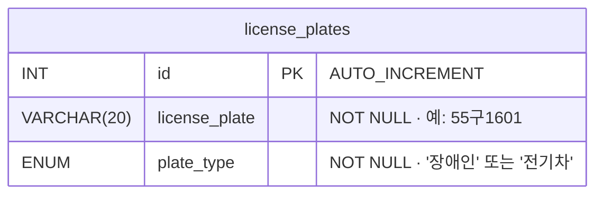

- **`license_plate`** — OCR 결과와 그대로 비교하도록 공백 없는 형식(`123가4567`)으로 저장
- **`plate_type`** — 구역 유형을 `ENUM`으로 제한해 잘못된 값 입력 방지, 장애인 · 전기차 구역별 확장 대비
- **시연 데이터** — 등록 차량 15대 (장애인 10 · 전기차 5), 구형 2자리 · 신형 3자리 번호판 모두 포함
- 스크립트를 다시 실행하면 DB를 지우고 새로 만들어, 시연 전 등록 목록을 쉽게 초기화 · 수정

<p>
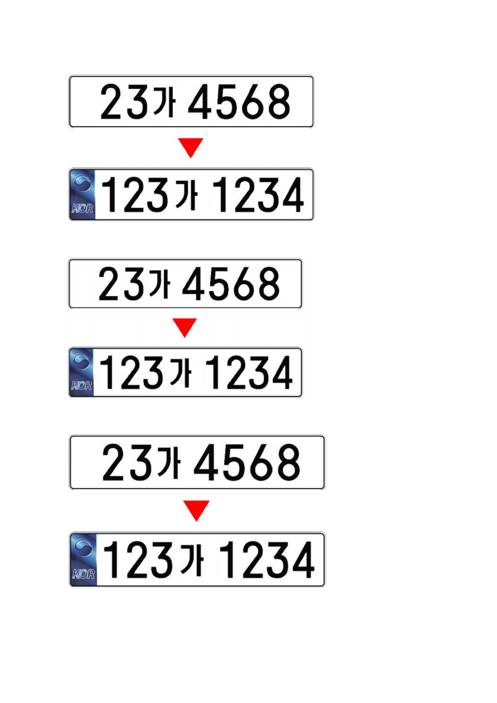
</p>
<sub>시연용 번호판 출력물 — 구형 <code>23가 4568</code>(DB 등록) · 신형 <code>123가 1234</code>(미등록)</sub>

---

## 처리 흐름

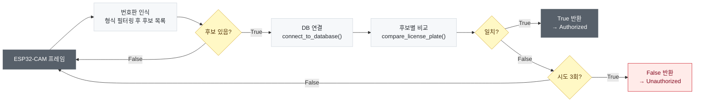

- **정확 일치 비교** — `SELECT * FROM license_plates WHERE license_plate = %s`
  - 문자열을 쿼리에 직접 붙이지 않고 **파라미터 바인딩**으로 전달
- **공백 제거** — OCR은 `154러 7070`처럼 띄어 읽기 때문에 DB 형식에 맞춰 공백을 제거한 뒤 비교
- **후보 여러 개 처리** — 한 프레임에서 형식에 맞는 번호판이 여러 개 나오면 하나라도 일치하는지 확인
- **반복 인식** — OCR 오인식을 고려해 최대 3회 시도, **한 번이라도 일치하면 등록 차량**으로 판단
- **연결 실패 처리** — DB 연결에 실패하면 즉시 `False`를 반환해 미등록과 같은 안전한 쪽으로 동작

---

## 판단 결과와 볼라드 동작

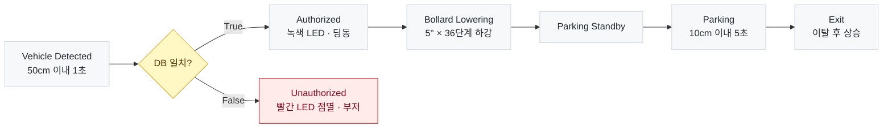

- DB 판단 결과는 차량이 **30cm 이내로 1초 이상** 다가왔을 때 Authorized / Unauthorized 상태로 반영
- 미승인 차량이 **30cm 밖으로 2초 이상** 벗어나면 다시 대기 상태로 복귀

<p>


</p>
<sub>왼쪽: DB 일치 → 볼라드 하강 / 오른쪽: DB 불일치 → 빨간 LED 점멸, 볼라드 유지</sub>

---

## 개발 과정

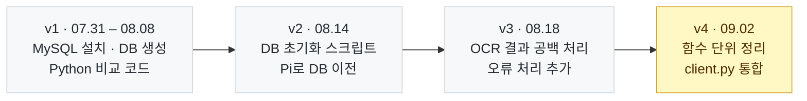

- **v1** — MySQL · Workbench 설치, `bola` DB와 `license_plates` 테이블 생성, 임의 번호판으로 Python 비교 코드 작성
- **v2** — `DROP ... IF EXISTS`로 반복 실행 가능한 스크립트로 변경, `mysqldump`로 백업해 Raspberry Pi에 이전
- **v3** — 실제 OCR 출력(`154러 7070`)으로 테스트하며 공백 제거, 연결 오류 처리 추가
- **v4** — DB 연결 · 비교를 함수로 분리해 팀원의 인식 · 제어 코드에 바로 붙일 수 있게 정리 → 최종 `client.py`에 통합

버전별 코드는 [`archive/`](archive/README.md) 참고

---

## 개발 과정에서 해결한 문제

**① `ModuleNotFoundError: No module named 'mysql'`**
- 원인: 커넥터를 설치한 Python과 코드를 실행한 Python 환경이 달랐음
- 해결: 가상환경(`myenv`)을 만들어 `mysql-connector-python`을 설치하고 같은 환경에서 실행

**② `Unknown column 'plate_number' in 'where clause'`**
- 원인: 비교 쿼리의 컬럼 이름이 실제 테이블 컬럼(`license_plate`)과 달랐음
- 해결: `DESCRIBE license_plates`로 스키마를 확인한 뒤 쿼리 컬럼명 수정

<p>
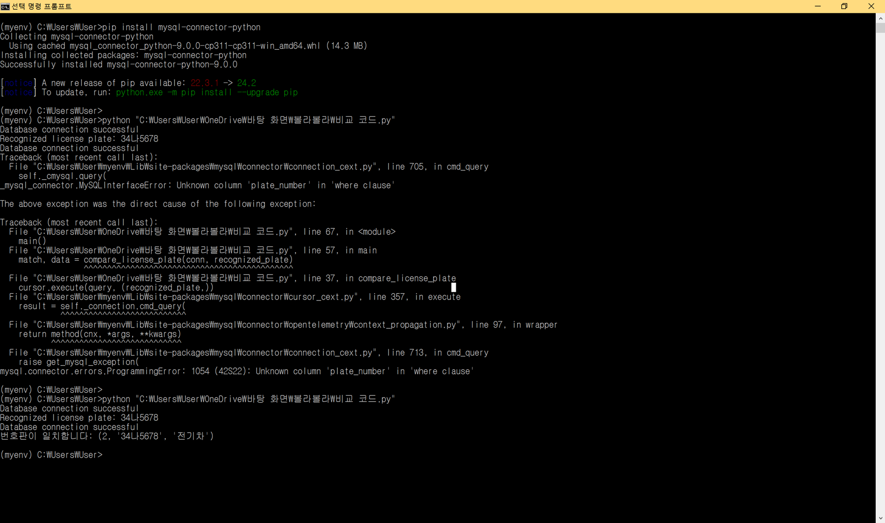
</p>
<sub>컬럼명 오류 발생 후 수정해 일치 결과(<code>(2, '34나5678', '전기차')</code>)를 받은 실행 로그</sub>

**③ Raspberry Pi에 MySQL 설치 실패**
- 원인: Raspberry Pi OS에서 MySQL 서버 설치 · 사용자 권한 설정 오류
- 해결: MySQL 호환 DB인 **MariaDB**로 바꿔 설치하고 사용자 권한을 재설정
  - 노트북 DB를 `mysqldump`로 백업 → `scp`로 Pi에 전송 → 복원해 동일한 DB 구성

<p>
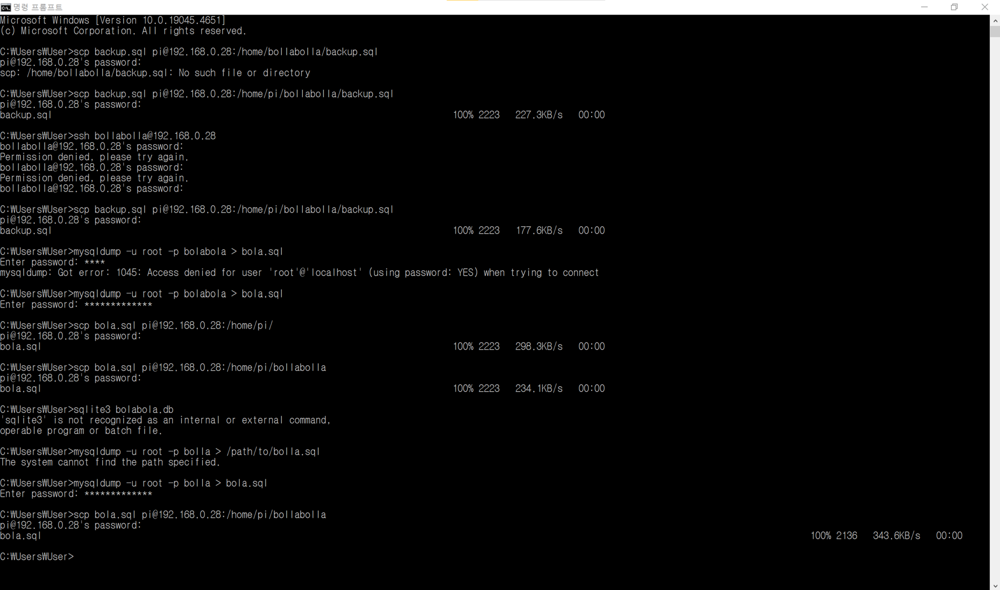
</p>
<sub>노트북 DB를 덤프해 Raspberry Pi로 옮기는 과정 — 경로 · 권한 오류를 하나씩 해결</sub>

**④ Raspberry Pi에서 PyTorch 설치 불가**
- 원인: 번호판 인식에 쓰는 EasyOCR이 PyTorch를 필요로 하는데, Pi 하드웨어 사양과 호환되지 않음
- 해결: 팀원들과 논의해 실행 환경을 **PC(Windows)** 로 변경, PC에서 DB를 다시 구성하고 전체 코드 동기화 · 통합 테스트

**⑤ 팀원 코드와의 통합**
- 원인: 처음에는 연결 · 비교 · 테스트 출력이 하나의 스크립트에 섞여 있어 다른 코드에 붙이기 어려움
- 해결: `connect_to_database()` · `compare_license_plate()`로 기능을 분리하고, 결과를 `True` / `False`로 반환하도록 정리

---

## 정리하며 발견한 개선점

공모전 이후 최종 코드를 다시 보면서 확인한 점입니다.

- **DB 접속 정보 하드코딩** — 비밀번호가 코드에 직접 작성되어 있었음 → [`src/plate_db.py`](src/plate_db.py)는 환경변수(`BOLLA_DB_*`)로 받도록 변경
- **인식 시도마다 DB 재연결** — 프로그램 시작 시 한 번 연결해 재사용하는 구조가 효율적
- **같은 번호판 중복 등록 가능** — `license_plate`에 `UNIQUE` 제약이 없어 등록 관리 기능 추가 시 필요
- **번호판이 계속 안 읽히는 경우** — 시도 횟수가 후보가 나온 프레임에서만 늘어나, 프레임 단위 카운트나 시간 제한이 필요

---

## 한계와 확장 방향

**한계**
- 로컬 DB 서버 기반이라 관리자 화면 · 원격 등록 기능 없음
- 번호판 문자열 정확 일치만 비교해, OCR이 한 글자만 틀려도 미등록으로 판단
- 출입 기록(언제 · 어떤 차량이 들어왔는지)은 저장하지 않음

**확장 방향**
- 출입 기록 테이블 추가로 구역별 이용 패턴 분석
- 모바일 앱 · 웹 관리 화면에서 차량 등록 · 삭제
- 클라우드 DB로 여러 볼라드가 하나의 등록 목록 공유

<details>
<summary>직접 실행해 보기</summary>

```bash
pip install -r requirements.txt

# DB · 테이블 생성 (기존 bolla DB는 삭제 후 새로 생성)
mysql -u root -p < sql/database.sql

# 번호판 조회
export BOLLA_DB_PASSWORD=<비밀번호>
python src/plate_db.py 55구1601      # → 등록 차량
python src/plate_db.py 123가1234     # → 미등록 차량
```

전체 시스템(카메라 · 볼라드 제어)은 [팀 원본 저장소](https://github.com/Yunseo-Cho/2024ESWContest_free_1090)의 `client.py`로 실행합니다.
</details>
